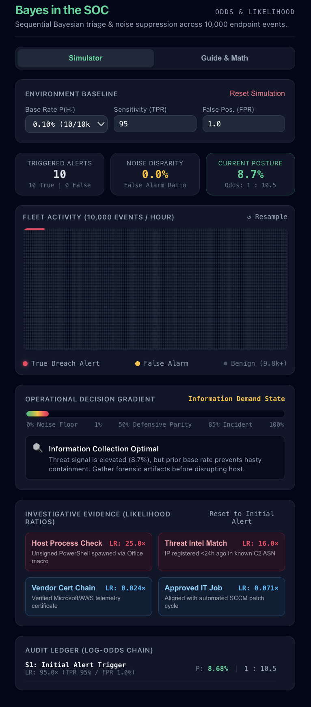

## Bayes Theorem App - Security Operations Center Analysis

# Bayes in the SOC: The Ultimate Guide to Busting False Alarms



Welcome to **Bayes in the SOC**! 

Have you ever wondered why school fire alarms go off because someone burned toast, or why security systems sound terrifying alarms when nothing bad actually happened? 

In cybersecurity, companies protect thousands of laptops and servers. They set up automated security cameras and alarms in what is called a **SOC** (Security Operations Center). The tools they buy claim to be **95% or 99% accurate**. Yet, when analysts sit down at their screens every morning, **over 90% of the alerts are completely bogus!**

This web app lets you step into the shoes of a cyber detective to see why this happens, how math explains it (the **False Positive Paradox**), and how a 250-year-old math formula called **Bayes' Theorem** helps you solve real cyber crimes without chasing ghosts.

---

## Navigation & App Modes

At the very top of the app, you will find a clean segmented navigation bar to switch between two distinct views:

```
┌──────────────────────────────────────────────┐
│  [ Simulator ]         [ Guide & Math ]      │
└──────────────────────────────────────────────┘
```

* **Simulator Tab:** The interactive investigation dashboard where you run live experiments across 10,000 endpoint events, trigger security alarms, inject forensic evidence, and watch your breach probability shift in real time.
* **Guide & Math Tab:** An embedded, self-contained reference guide built right into the app. It breaks down the fire alarm paradox, details the visual event canvas, walks step-by-step through the Bayes odds formula, and explains the operational decision thresholds—no external documentation required!

---

## The Big Mystery: The Fire Alarm Analogy

Imagine your high school has a super-fancy fire detector:
* If there is an actual fire, it rings **95% of the time** (awesome!).
* If there is **no** fire, it accidentally blares **1% of the time** (sounds tiny, right?).

Now imagine the alarm goes off on a random Tuesday morning. **What is the chance there is an actual fire? 95%?**

**Nope! It's usually less than 10%!**

Why? Because actual fires are **super rare** (maybe 1 day every 1,000 school days). But normal, boring, fire-free days happen all the time (999 days). That 1% accidental mistake happens so often across normal days that almost every time the bell rings, someone just burnt popcorn in the teachers' lounge!

That is the **Base Rate Fallacy**, and this app lets you see it in real time with 10,000 computer events.

---

## Tour of the App: Inputs, Outputs & Controls

Here is a breakdown of every section available in the **Simulator** tab:

```
┌─────────────────────────────────────────────────────────────┐
│ 1. ENVIRONMENT BASELINE (Settings)                          │
├─────────────────────────────────────────────────────────────┤
│ 2. KEY METRICS RIBBON (Quick Stats)                         │
├─────────────────────────────────────────────────────────────┤
│ 3. FLEET ACTIVITY CANVAS (10,000 Events Dot Matrix)         │
├─────────────────────────────────────────────────────────────┤
│ 4. OPERATIONAL DECISION GRADIENT (The Smart Action Meter)   │
├─────────────────────────────────────────────────────────────┤
│ 5. INVESTIGATIVE EVIDENCE DECK (Detective Clue Buttons)     │
├─────────────────────────────────────────────────────────────┤
│ 6. AUDIT LEDGER (Step-by-Step Crime Log)                    │
└─────────────────────────────────────────────────────────────┘
```

---

### Section 1: Environment Baseline (The Setup)

This is where you set up the rules of your network:

* **Base Rate $P(H_1)$ (Dropdown):** 
  * *What it means:* How common are real hacker attacks in your network?
  * *Example:* `0.10% (10/10k)` means out of 10,000 computers, only 10 are actually infected with ransomware. The other 9,990 are completely innocent.
* **Sensitivity (TPR - True Positive Rate):**
  * *What it means:* How good is your automated alarm at catching real bad guys?
  * *Default:* `95%`. If 100 bad guys try to break in, the alarm catches 95 of them.
* **False Pos. (FPR - False Positive Rate):**
  * *What it means:* How often does the alarm go off on innocent traffic by accident?
  * *Default:* `1.0%`. Out of 100 innocent things, it accidentally screams at 1 of them.
* **Reset Simulation (Red Button):**
  * Wipes the slate clean and starts a fresh simulation with your chosen settings.

---

### Section 2: Key Metrics Ribbon (The Scoreboard)

Right below the settings, you see three cards summarizing the situation:

1. **Triggered Alerts:**
   * Shows the total number of alarms blaring on the security screen.
   * *Example:* `124 Alerts` split into `50 True | 74 False`. Notice how many false alarms there are!
2. **Noise Disparity (False Alarm Ratio):**
   * The percentage of ringing alarms that are complete garbage.
   * *Example:* `59.7%` or `90.8%`. This is why security analysts get burned out ("alert fatigue")!
3. **Current Posture (Your Confidence):**
   * **The Big Number:** The actual probability ($P$) that the alert you are investigating is a genuine breach.
   * **The Odds:** Shows the betting odds (e.g., `Odds: 1 : 2.1` means for every 1 chance it's real, there are 2.1 chances it's fake).

---

### Section 3: Fleet Activity (The 10,000 Dot Canvas)

This visual is an **Icon Array / Frequency Grid** simulating **10,000 computer actions** happening in one hour across a company (125 columns by 80 rows):

* **Dark Blue/Slate Dots:** Normal, boring computer activity that passed quietly without an alarm (about 9,800+ dots).
* **Flashing Pink/Red Dots (True Breach Alerts):** Actual hackers that triggered the alarm.
* **Yellow/Amber Dots (False Alarms):** Innocent programs (like a Spotify update or Windows patch) that accidentally tripped the alarm.
* **↺ Resample Button:** Roll the dice again! It shuffles and simulates a new hour of network traffic.

**The "Aha!" Moment:** Look at how many yellow dots there are compared to flashing red dots. When an alarm rings, you are much more likely to be looking at a yellow dot than a red one!

---

### Section 4: Operational Decision Gradient (What Should You Do?)

In real life, you don't just guess red or green. Every action has a cost. If you unplug a computer that belongs to the hospital surgeon during an operation, you better be sure it's actually hacked!

This meter shifts smoothly across four stages:

1. **Noise Floor Cleared (0% to 1% - Green):**
   * *The Posture:* **Autonomous Ticket Dismissal 🛡️**
   * *What to do:* The chance of a hack is tiny. Spending human time checking it costs more than the risk. Safely close the ticket and move on!
2. **Information Demand State (1% to 50% - Yellow/Amber):**
   * *The Posture:* **Information Collection Optimal 🔍**
   * *What to do:* The alarm went off, but you don't have enough proof to unplug the computer yet. Collect more clues!
3. **Defensive Intervention Parity (50% to 85% - Orange/Pink):**
   * *The Posture:* **Precautionary Host Isolation Warranted ⚡**
   * *What to do:* The scale has tipped. It is now more dangerous to do nothing than to temporarily disconnect the computer while you finish checking.
4. **Terminal Certainty / Active Incident (85% to 100% - Red):**
   * *The Posture:* **Incident Response Escalation 🚨**
   * *What to do:* 5-alarm fire! The machine is definitely compromised. Activate the emergency team and wipe the virus!

---

### Section 5: Investigative Evidence Deck (Playing Detective)

When an alert triggers, you are stuck in the **Information Demand State** (~8% to 32% probability). You need more evidence!

Each button represents an investigation test with a **Likelihood Ratio (LR)**:
* If **$\text{LR} > 1$**, it points toward a **real attack** (Incriminating).
* If **$\text{LR} < 1$**, it points toward an **innocent mistake** (Exonerating).

#### The 4 Clue Buttons:
1. **Host Process Check ($\text{LR} = 25.0\times$):**
   * *The Clue:* A hacker command (`PowerShell`) secretly launched out of a Word document.
   * *Impact:* Super suspicious! Multiplies your odds by **25**.
2. **Threat Intel Match ($\text{LR} = 16.0\times$):**
   * *The Clue:* The computer is talking to a website that was registered only 12 hours ago in a known criminal hideout.
   * *Impact:* Very bad news! Multiplies your odds by **16**.
3. **Vendor Cert Chain ($\text{LR} = 0.024\times$):**
   * *The Clue:* The computer is talking to an official, verified Microsoft or Amazon cloud server.
   * *Impact:* Innocent! Multiplies your odds by **0.024** (cuts the suspicion down by 42 times).
4. **Approved IT Job ($\text{LR} = 0.071\times$):**
   * *The Clue:* The IT department had scheduled software updates at that exact minute.
   * *Impact:* Innocent! Cuts suspicion down by 14 times.
5. **Reset to Initial Alert:** Wipes your clues so you can try a different investigation path on the same alert.

---

### Section 6: Audit Ledger (The Math Paper Trail)

At the bottom of the screen, the **Audit Ledger** keeps an official log of how your confidence changed step by step.

Instead of complicated fractions, Bayes' Theorem works like simple multiplication when using **Odds**:

$$\text{New Odds} = \text{Old Odds} \times \text{Likelihood Ratio}$$

Every time you click a clue button, the log records:
* Which clue you examined.
* Its **$\text{LR}$ multiplier**.
* The updated **Probability ($P$)**.
* The new **Betting Odds**.

---

## Inside the "Guide & Math" Tab

Clicking **Guide & Math** in the top navigation reveals a dedicated educational view built right into the app:
1. **The Fire Alarm Paradox:** A quick overview of the popcorn analogy and base-rate distortion.
2. **Visual Legend Breakdown:** A clear guide to the 10,000-dot fleet canvas (benign vs. false positive vs. true positive).
3. **The 3-Step Math Formula:** A step-by-step mathematical demonstration showing how Prior Odds ($0.001001$) multiplied by the Sensor Likelihood Ratio ($95\times$) produces the initial $8.68\%$ posterior probability.
4. **Operational Action Thresholds:** Explanations of why modern security teams make decisions based on risk and interruption cost rather than simple colored badges.

---

## How to Make the Most of the App: 3 Experiments to Try

Ready to master Bayesian thinking? Try these three hands-on challenges:

### Experiment 1: The "Guilty" Path (Catching a Ransomware Breach)
1. Keep the base settings (`0.10% Base Rate`). Notice your alert starts around **8.8%**.
2. Click **Host Process Check** ($\text{LR} = 25.0\times$).
   * *Watch what happens:* The probability jumps from **8.8% to 70.7%**! The meter turns pink: *Precautionary Host Isolation Warranted*.
3. Click **Threat Intel Match** ($\text{LR} = 16.0\times$).
   * *Result:* The probability skyrockets to **97.5%**! The sirens sound: *Terminal Certainty / Active Incident*. You caught the hacker!

### Experiment 2: The "Innocent" Path (Clearing a False Alarm)
1. Hit **Reset to Initial Alert** (starts back at **8.8%**).
2. Click **Vendor Cert Chain** ($\text{LR} = 0.024\times$).
   * *Watch what happens:* The probability drops from **8.8% down to 0.23%**!
   * The meter turns green: *Noise Floor Cleared / Autonomous Ticket Dismissal*. You saved 2 hours of wasted investigation time!

### Experiment 3: The Danger of Extreme Rarity
1. Go up to **Base Rate** and switch it to `0.05% (5 in 10,000)`.
2. Notice how hard it is to convince the system something is real when it's that rare. Even with a 95% accurate alarm, the initial probability is only **4.5%**. 
3. This proves that **how rare something is in the real world matters just as much as how accurate your test is!**

---

## Quick Summary Cheatsheet

| Term | What It Means in Simple English |
| :--- | :--- |
| **Prior Base Rate** | How common the event is before you test anything. |
| **Sensitivity (TPR)** | How good your alarm is at catching real bad guys. |
| **False Positive (FPR)** | How often the alarm screams at innocent people. |
| **Posterior Probability** | Your updated confidence *after* looking at the clues. |
| **Likelihood Ratio (LR)** | The multiplier of a clue. $>1$ means guilty; $<1$ means innocent. |

Have fun exploring the simulator, testing different clue combinations, and seeing how math turns chaos into clear decisions!
